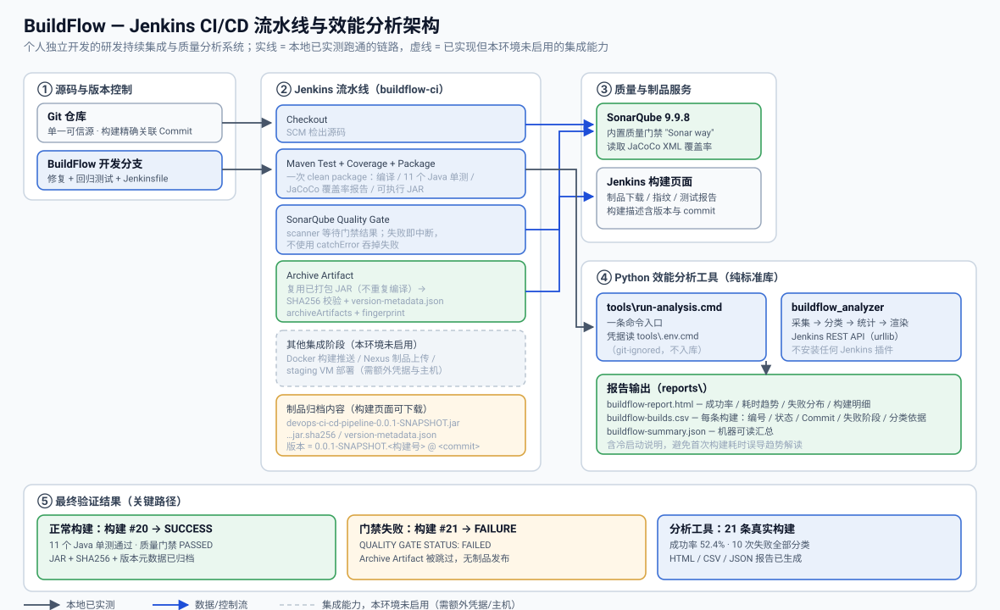

# BuildFlow

**研发持续集成与质量分析系统** — 一条真实可运行的 Jenkins 流水线，加上一套读取真实构建历史的 Python 效能分析工具。

本项目为个人独立设计与开发。目标是构建一条**端到端可验证**的研发流水线：代码提交后自动完成构建、单元测试、覆盖率采集、代码质量门禁校验与制品归档；并通过配套分析工具，把流水线的历史执行数据转化为可量化的效能指标与故障洞察。

---

## 一、系统架构



架构分为四个部分：

| 层次 | 职责 |
|---|---|
| **① 源码与版本控制** | Git 仓库作为唯一可信源；每次构建精确关联 Commit SHA |
| **② Jenkins 流水线** | 5 个 stage 串行把关：检出 → 构建测试覆盖率打包 → 质量门禁 → 制品归档 |
| **③ 质量与制品服务** | SonarQube 提供质量门禁判定；Jenkins 构建页面提供制品下载与指纹追溯 |
| **④ 效能分析工具** | 独立 Python 工具，通过 Jenkins REST API 采集历史数据，输出故障分类与效能报告 |

**关键设计原则：质量门禁是流水线的硬闸门。** 门禁阶段排在制品归档之前，门禁未通过时 Jenkins 会跳过归档阶段，因此不合格版本**在物理上无法产生可发布制品**。

---

## 二、技术栈

| 层次 | 选型 |
|---|---|
| 应用 | Java 17 · Spring Boot 3.3.0 · Lombok · springdoc-openapi |
| 构建 | Maven（Maven Wrapper 3.9.5） |
| 测试 | JUnit 5 · Mockito · Spring Boot Test |
| 持续集成 | Jenkins LTS（容器化）· Declarative Pipeline |
| 覆盖率 | JaCoCo 0.8.12 |
| 代码质量 | SonarQube 9.9.8 Community · sonar-maven-plugin 4.0.0.4121 |
| 效能分析 | Python 3.13（**仅标准库**，零第三方依赖） |
| 运行环境 | Windows + Docker Desktop（Linux 容器） |

---

## 三、核心功能

### 1. Jenkins 流水线（5 个 stage）

```
Checkout  →  Maven Test + Coverage + Package  →  SonarQube Quality Gate  →  Archive Artifact
                    │                                    │                          │
            11 个单测 + JaCoCo 报告              门禁 PASSED 才继续           JAR + SHA256 + 元数据
```

- **单次构建产出全部中间物**：一次 `clean package` 同时完成编译、单元测试、覆盖率报告与可执行 JAR 打包，后续 stage 直接复用该 JAR，不重复编译。
- **质量门禁硬阻断**：扫描器通过 `sonar.qualitygate.wait` 等待服务端计算完成，门禁为 ERROR 时以非零退出码结束，使流水线中断。**未使用 `catchError` 吞掉失败**。
- **制品全链路可追溯**：归档内容包含可执行 JAR、SHA256 校验文件与版本元数据，并使用 `archiveArtifacts` + `fingerprint`，可直接从构建页面下载与核验。
- **构建保留策略**：`buildDiscarder` 保留最近 30 个构建与其制品，避免磁盘无限增长；并设置 30 分钟 stage 超时。

### 2. 制品追溯机制

每次成功构建归档三个文件：

```
artifact/devops-ci-cd-pipeline-0.0.1-SNAPSHOT.jar
artifact/devops-ci-cd-pipeline-0.0.1-SNAPSHOT.jar.sha256
artifact/version-metadata.json
```

`version-metadata.json` 把制品与构建环境绑定：

```json
{
  "application": "devops-ci-cd-pipeline",
  "artifact": "devops-ci-cd-pipeline-0.0.1-SNAPSHOT.jar",
  "version": "0.0.1-SNAPSHOT.20",
  "build_number": "20",
  "build_url": "http://127.0.0.1:8080/job/buildflow-ci/20/",
  "git_commit": "1e1ead291c4f7ebce45e7818f3df156daf9e16c4",
  "git_commit_short": "1e1ead2",
  "jenkins_job": "buildflow-ci",
  "sonar_project_key": "devops-ci-cd-pipeline"
}
```

追溯路径：**版本号 `0.0.1-SNAPSHOT.20` → 构建 #20 → commit `1e1ead2`**，构建页面描述同步显示为 `v0.0.1-SNAPSHOT.20 @ 1e1ead2`。

### 3. Python 构建效能分析工具

约 1800 行纯标准库 Python，通过 Jenkins REST API 读取真实构建历史并产出分析报告。

**数据采集**：构建编号、状态、起止时间、执行耗时、Git Commit SHA、失败阶段、控制台错误摘要。支持通过配置或环境变量指定 Jenkins 地址、Job 名称与读取数量，**认证信息仅从环境变量读取**。

**规则式故障分类**（6 类，命中即返回，证据不足输出 `UNKNOWN` 而不猜测）：

| 类型 | 含义 | 典型证据 |
|---|---|---|
| `GIT_CHECKOUT` | Git 拉取失败 | `dubious ownership`、`Could not read from remote repository` |
| `MAVEN_COMPILE` | Maven 编译失败 | `COMPILATION ERROR`、`cannot find symbol` |
| `UNIT_TEST` | 单元测试失败 | `Tests run: N, Failures: 1`、surefire 失败 |
| `SONAR_QUALITY_GATE` | 质量门禁失败 | `QUALITY GATE STATUS: FAILED` |
| `ENVIRONMENT` | 环境或依赖问题 | 依赖解析失败、脚本权限/行尾问题、缺失的 Pipeline 步骤 |
| `UNKNOWN` | 未知原因 | 无规则命中 |

每条分类同时输出**故障类型、判断依据、错误摘要**，可人工复核。

**效能统计**：构建总次数、成功/失败次数、成功率、平均与中位耗时、耗时变化趋势、故障类型数量及占比。

**报告输出**：HTML（内联 SVG 趋势图，无 CDN 依赖）/ CSV / JSON 三种形式。

---

## 四、技术难点与解决思路

### 难点 1：质量门禁必须真正阻断发布，而非"只扫描不校验"

仅执行 `sonar:sonar` 只会上传分析结果，即使质量不合格构建也会"成功"。解决方案是启用扫描器侧的门禁等待（`sonar.qualitygate.wait=true`，由 Maven `quality` profile 提供），并**把归档阶段排在门禁之后**——门禁失败时该 stage 被 Jenkins 自动跳过。同时明确移除 `catchError(buildResult:'SUCCESS', ...)` 这种会吞掉失败的写法。

> 该机制经过对抗性验证：临时把门禁改为不可能通过后，构建转为 FAILURE，日志出现 `QUALITY GATE STATUS: FAILED`，且归档阶段被跳过、`artifact/` 下无任何产物。

### 难点 2：失败阶段的识别（Declarative Pipeline 的"假阶段"陷阱）

Jenkins 原生阶段 REST API 由额外插件提供。为遵守"不安装不必要插件"的约束，改为从控制台日志中恢复阶段边界。

此处有一个隐蔽陷阱：**Declarative Pipeline 在失败后仍会"进入"后续每一个阶段，然后跳过其主体**。因此日志中最后一个阶段往往是**被跳过**的阶段，而不是真正失败的那个。解析逻辑因此改为：取「最后一个真正执行过、且其主体不含 `skipped` 提示」的阶段；若某阶段有开始标记却无结束标记，则判定构建死于该阶段内部。

### 难点 3：证据窗口过窄导致误判为 UNKNOWN

初期只检索日志末尾固定长度，但 Jenkins 在报错时会打印数 KB 的可用步骤清单（如 `No such DSL method ... found among steps`），把真正的错误信息挤出了窗口。解决方案是**优先检索失败阶段自身的输出块**，并以日志全尾作为补充证据源，两者在报告中区分标注以保持证据可追溯。

### 难点 4：冷启动对耗时趋势的干扰

首次完整执行流水线需下载 Maven 与全部依赖，耗时可达后续构建的数倍，会把线性趋势斜率显著拉向"变快"，造成误导。

识别逻辑**按耗时判定而非按位置判定**——早期失败的构建只运行几秒，若按"第一个构建"识别会选错对象。最终实现：候选构建需运行 ≥30s，且耗时 ≥ 其余构建中位数的 2 倍，并在报告中给出显式说明。

### 难点 5：跨平台构建一致性

仓库缺少行尾策略声明，Windows 检出会把 `mvnw` 改写成 CRLF，导致 Linux 容器内 `sh ./mvnw` 解析失败（`Syntax error: word unexpected`）；同时 `mvnw` 的 Git 权限位为 `100644`，缺少可执行位。

解决方案：新增 `.gitattributes` 声明 `* text=auto eol=lf` 与 `*.cmd text eol=crlf`，并将 `mvnw` 的索引权限修正为 `100755`。

---

## 五、使用方法

### 前置条件

- Docker Desktop（Linux 容器模式）
- Python 3.13
- 本机 8080（Jenkins）、9000（SonarQube）端口可用

### 步骤 1：启动服务

```powershell
D:\work\buildflow\start-jenkins.ps1     # Jenkins + 初始化（服务注册、登录认证、git 配置）
docker start sonarqube nexus
```

Jenkins 访问地址：<http://127.0.0.1:8080/job/buildflow-ci/>

### 步骤 2：触发流水线

```powershell
D:\work\buildflow\trigger-build.ps1
```

或在 Jenkins 页面点击 **Build Now**。

### 步骤 3：下载并校验制品

构建页面 → **Artifacts** → 下载 JAR，然后校验完整性：

```powershell
Get-FileHash .\devops-ci-cd-pipeline-0.0.1-SNAPSHOT.jar -Algorithm SHA256
# 与归档的 .sha256 文件内容比对
```

### 步骤 4：生成效能分析报告

```bat
copy tools\.env.example.cmd tools\.env.cmd
REM 编辑 tools\.env.cmd，填入 JENKINS_URL / JENKINS_USER / JENKINS_TOKEN / JENKINS_JOB
tools\run-analysis.cmd
```

报告输出至 `reports\`：

```
reports/buildflow-report.html      # 浏览器打开
reports/buildflow-builds.csv       # 每条构建的明细与分类依据
reports/buildflow-summary.json     # 机器可读汇总
```

---

## 六、完整演示流程

```powershell
# 1. 启动环境
D:\work\buildflow\start-jenkins.ps1
docker start sonarqube nexus
Start-Sleep -Seconds 60                 # 等待 SonarQube 就绪

# 2. 正常构建：11 个单测通过 → 质量门禁 PASSED → 制品归档
D:\work\buildflow\trigger-build.ps1

# 3. 验证质量门禁确实阻断发布（临时构造不可通过的门禁条件）
D:\work\buildflow\verify-gate-failure.ps1
#    预期：构建 FAILURE；日志出现 QUALITY GATE STATUS: FAILED；
#          归档阶段被跳过；构建页面 artifact/ 下无任何制品

# 4. 生成并查看效能报告
cd D:\work\buildflow\dev
tools\run-analysis.cmd
start reports\buildflow-report.html
```

---

## 七、实际验证成果

以下数据均来自本机真实执行记录，非示意数据。

### 1. Java 测试与覆盖率

| 指标 | 实测值 |
|---|---|
| Java 单元测试 | **11 项全部通过**（4 个测试类） |
| 行覆盖率 | **87.9%**（29 / 33 行） |
| 分支覆盖率 | 43.3% |
| 整体覆盖率 | 66.7% |
| 代码行数 (ncloc) | 188 |
| Bugs / 漏洞 / 重复率 | 0 / 0 / 0.0% |
| 代码异味 | 3（1 条为"空测试无断言"，位于原有 `contextLoads`） |

测试构成：`DemoApplicationTests`（1）· `CustomerControllerTest`（3）· `CustomerServiceTest`（2）· `CustomerRepositoryRegressionTest`（5）。

其中 `CustomerRepositoryRegressionTest` 为**不使用 Mockito 的真实回归测试**，直接驱动真实 Repository，并用稀疏 ID（10/20/30）使客户 ID 与列表下标错位，覆盖 `findById` 的索引误用缺陷。

### 2. 流水线关键路径验证

| 验证项 | 构建 | 结果 |
|---|---|---|
| 正常构建 | **#20** | `SUCCESS` · 11 个单测通过 · `QUALITY GATE STATUS: PASSED` · JAR + SHA256 + 版本元数据已归档 · 耗时 95.3s |
| 质量门禁失败 | **#21** | `FAILURE` · `QUALITY GATE STATUS: FAILED` · `Stage "Archive Artifact" skipped` · `artifact/` 下**无任何制品** |

### 3. 构建效能分析（真实历史）

分析工具读取 **21 条真实构建记录**：

| 指标 | 实测值 |
|---|---|
| 构建总次数 | 21 |
| 成功 / 失败 | 11 / 10 |
| 构建成功率 | **52.4%** |
| 平均耗时 | 96.28s |
| 耗时中位数 | 76.28s |
| 趋势 | 下降（-36.38 秒/小时） |
| 排除项（进行中 / 已取消） | 0 / 0 |
| 未分类失败 | **0**（10 次失败全部分类） |

失败类型分布：

| 故障类型 | 次数 | 占比 | 真实成因 |
|---|---|---|---|
| `ENVIRONMENT` | 5 | 50.0% | `mvnw` 缺少可执行位、CRLF 破坏 shell 脚本、调用了未安装的 Pipeline 步骤、构建链接未配置 |
| `SONAR_QUALITY_GATE` | 4 | 40.0% | 质量门禁未通过（含主动构造的阻断验证） |
| `GIT_CHECKOUT` | 1 | 10.0% | `dubious ownership` 导致 Git 拒绝读取仓库 |

> 说明：失败样本中包含为验证门禁阻断能力而**主动构造**的构建。这些是流水线自身的演进与验证记录，并非系统的最终状态。

### 4. 分析工具自身测试

Python 工具附带 **19 个单元测试**，覆盖阶段解析（含"被跳过阶段"陷阱）、六类故障分类规则、`UNKNOWN` 回退、成功率口径、失败占比口径、趋势方向、冷启动识别与 Commit 提取，全部通过。

---

## 八、项目结构

```
.
├── Jenkinsfile                                  # 流水线定义（核心交付物）
├── pom.xml                                      # JaCoCo、SonarQube 扫描器与 quality profile
├── src/
│   ├── main/java/com/devops/demo/                # 应用源码（controller / service / repository / entity）
│   ├── main/resources/                           # 配置与静态页面
│   └── test/java/com/devops/demo/                # 4 个测试类，共 11 项测试
├── docs/
│   └── buildflow-architecture.svg               # 系统架构图
├── tools/                                       # Python 效能分析工具
│   ├── run-analysis.cmd                         # 一条命令入口（Windows）
│   ├── .env.example.cmd                         # 凭据模板（真实 .env.cmd 已被 gitignore）
│   └── buildflow_analyzer/
│       ├── run.py                               # CLI：采集 / 统计 / 出报告 / 离线分类
│       ├── jenkins_client.py                    # Jenkins REST 客户端（标准库）
│       ├── classifier.py                        # 阶段解析 + 规则式故障分类
│       ├── analysis.py                          # 效能统计与冷启动识别
│       ├── reporting.py                         # CSV / HTML / JSON 渲染
│       ├── models.py                            # 数据模型与故障分类枚举
│       ├── sample_data.py                       # 演示数据（报告明确标注 DEMO）
│       └── tests/                               # 19 个规则与口径单元测试
├── reports/                                     # 分析报告输出（生成物，已被 gitignore）
└── LICENSE
```

---

## 九、当前功能状态

为避免歧义，明确区分"已在本地启用并验证"与"已实现但未在本环境启用"的能力。

| 能力 | 状态 |
|---|---|
| Git 检出 / Maven 构建 / 单元测试 / JaCoCo 覆盖率 | ✅ 已启用并验证 |
| SonarQube 扫描与质量门禁硬阻断 | ✅ 已启用并验证 |
| 制品归档（JAR + SHA256 + 版本元数据 + 指纹） | ✅ 已启用并验证 |
| Python 构建效能分析与故障分类 | ✅ 已启用并验证 |
| Nexus 制品仓库发布 | ⚠️ **未启用** — 需要 Nexus 服务与对应凭据 |
| Docker Hub 镜像构建与推送 | ⚠️ **未启用** — 需要镜像仓库凭据 |
| 远程环境部署 | ⚠️ **未启用** — 需要可 SSH 的目标主机 |

上述三项未启用能力**不在当前流水线中执行**，本项目不将其描述为已完成的本地流水线能力。

---

## 十、已知限制

1. **阶段信息来自控制台日志解析**，而非 Jenkins 原生阶段 API（该 API 由未安装的插件提供）。这是为满足"不安装不必要插件"约束所做的取舍，代价是对日志格式存在依赖；解析逻辑已由单元测试固定。
2. **SonarQube 的 `new_coverage` 门禁条件在首次分析时不参与判定**：项目缺少新代码基线，"new code"指标未注入，因此门禁实际评估其余条件。建立基线后该条件即生效。
3. **覆盖率统计为模块整体口径**，未覆盖行集中在 `main` 方法与 Lombok 生成的 `equals/hashCode`，不属于业务逻辑。项目**未设置缺乏依据的覆盖率阈值**。
4. **应用数据存储于内存**（`ArrayList`），重启后丢失，未接入数据库——本项目聚焦于流水线与质量工程，而非业务持久化。

---

## 十一、安全实践

- 所有凭据（Jenkins API Token、SonarQube Token、服务口令）**仅存在于环境变量或仓库外的凭据目录**，不写入代码、报告、日志或 Git 提交。
- 生成的报告与示例中**不含任何真实口令或 Token**（已全量扫描确认）。
- Jenkins、SonarQube、Nexus 端口均只绑定 `127.0.0.1`，不对局域网开放。
- Jenkins 已启用登录认证，并关闭匿名读取权限。

---

## 十二、许可证

本项目采用 MIT 许可证，详见 [LICENSE](LICENSE)。
